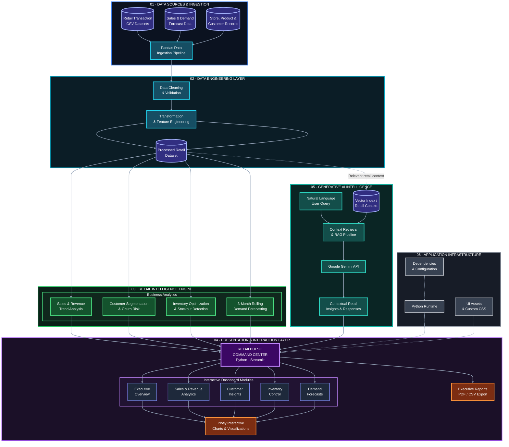

# RetailPulse: Enterprise Retail Intelligence & Demand Forecasting Platform

## 🌟 Executive Summary
RetailPulse is an enterprise-grade, multi-variate retail analytics and predictive demand forecasting dashboard built using Python and Streamlit. Designed for modern retail operations, it aggregates and analyzes **21,228 transactional records** across **30 global stores spanning 7 countries.**

The platform features a cohesive "Moody Supermarket" glassmorphism aesthetic, high UI responsiveness, real-time stockout risk flags, and an integrated RAG-powered AI assistant to help store managers and executives optimize inventory turnover and reduce customer churn.

# RetailPulse — 3D System Architecture

The following architecture illustrates the complete RetailPulse workflow, from transactional data ingestion to retail analytics, demand forecasting, interactive dashboards, and AI-assisted decision support.



## Architecture Layers

| Layer | Responsibility | Technologies |
|---|---|---|
| Data sources | Retail transactions, sales, stores, products and customers | CSV, Pandas |
| Data engineering | Cleaning, validation, transformation and feature preparation | Python, Pandas, NumPy |
| Intelligence engine | Revenue analysis, churn risk, inventory control and demand forecasting | Python, statistical and forecasting logic |
| Presentation | Interactive dashboards, charts, navigation and report exports | Streamlit, Plotly, HTML, CSS |
| Generative AI | Natural-language questions and contextual retail insights | RAG pipeline, Gemini API, vector index |
| Infrastructure | Runtime, dependencies, styling and asset management | Python, Pathlib, Base64 |

## Data Flow

1. **Ingest:** Load the raw retail datasets and any available forecast data.
2. **Prepare:** Clean, validate and transform the data into an analysis-ready format.
3. **Analyze:** Calculate sales trends, customer churn risk, inventory indicators and demand forecasts.
4. **Visualize:** Present analytical results through interactive Streamlit pages and Plotly visualizations.
5. **Assist:** Retrieve relevant retail context and use the configured AI pipeline to answer user questions.
6. **Export:** Generate executive reports in PDF or CSV format.

## Important Implementation Note

This diagram represents the intended logical architecture. The actual implementation should determine which modules, datasets and integrations are active. In particular, a true RAG pipeline requires a working retrieval mechanism and indexed context; merely connecting a Gemini API does not establish RAG functionality. Likewise, churn prediction and demand forecasting should be described as predictive models only if those models are implemented and evaluated.


## 🚀 Key Features & Analytical Modules
1. **Executive Landing Command Center (app.py):**

   * Immersive moody supermarket aisle background with dark gradient overlays.

   * Real-time metric trackers: **$1.25M+ Total Revenue, 8.4% Churn Rate, 5,000+ Active SKUs,** and **30 Stores across 7 Countries.**

   * Quick action navigation cards enabling instant switching across modules.

2. **Sales & Revenue Trends:**

   * Historical pattern analysis and revenue tracking with multi-currency and regional filtering.

3. **Customer Insights & Churn Prediction:**

   * Behavioral segmentation mapping and risk score probabilities to target high-value retaining campaigns.

4. **Inventory Optimization & Control:**

   * Stock turnover ratios, holding cost assessments, and automated low-stock indicators.

5. **Demand Forecasting & Rolling Trends:**

   * 3-month rolling average demand predictions utilizing time-series modeling.

   * Automated color-coded stockout risk flags (Low, Medium, Critical).

6. **RetailPulse AI Assistant:**

   * Simulated RAG and Gemini-powered query assistant designed to interpret natural language queries over the 21,228 record dataset.

## 🛠️ Tech Stack & Dependencies

   **Frontend & UI Framework:** Streamlit (with custom HTML/CSS glassmorphic styling & Base64 image injection).

   **Data Processing & Manipulation:** Pandas, NumPy.

   **Data Visualization:** Plotly Express (interactive area charts, donut charts, trend lines).

   **Environment & Deployment:** Python 3.10+, Pathlib, Base64 encoding.

## 🧗‍♂️ Technical Challenges & Solutions
During the development of RetailPulse, our engineering team encountered and successfully solved several complex UI/UX and performance hurdles:

1. **Background Image Scaling & Content Overlap**

   **Challenge:** Applying full-screen background images caused high-resolution store photos to zoom aggressively, obscuring charts, tables, and text elements, making them unreadable.

   **Solution:** Developed a dual-layer CSS background injector utilizing a fixed dark semi-transparent gradient (rgba(11, 15, 25, 0.75)) combined with precise CSS positioning (background-size: cover; background-attachment: fixed;) to preserve background depth while maintaining crisp contrast for text and cards.

2. **Streamlit Sidebar Navigation Accessibility**

   **Challenge:** Standard CSS resets used to hide Streamlit's default top header (header[data-testid="stHeader"]) accidentally stripped away the sidebar collapse/expand arrow toggle (collapsedControl), locking users out of multi-page navigation.

   **Solution:** Refined the CSS injection rule to keep the header transparent (background-color: transparent !important) while explicitly targeting and styling the collapse button ([data-testid="collapsedControl"]) with custom glassmorphism borders and high z-index layering.

3. **Native Button Layout Alignment in Card Containers**

   **Challenge:** Integrating Streamlit's native st.download_button() inside custom HTML container divs caused the button to detach and float outside card borders.

   **Solution:** Replaced rigid HTML wrapper mixing with Streamlit's native container elements (st.container(border=True)) and structured grid columns (st.columns), ensuring clean alignment and consistent padding across all viewports.

## ⚙️ Installation & Local Setup
1. **Clone the Repository:**
```
git clone https://github.com/your-username/retailpulse.git
cd retailpulse
```

2. **Install Dependencies:**
```
pip install -r requirements.txt
```

3. **Verify Asset Files:**
  * Ensure your background image (Moody Supermarket Aisle Background.png) is placed inside the dashboard/assets/ directory.

4. **Run the Streamlit Application:**
```
streamlit run app.py
```